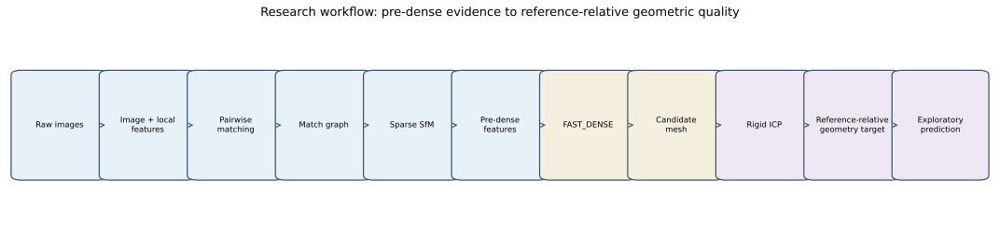
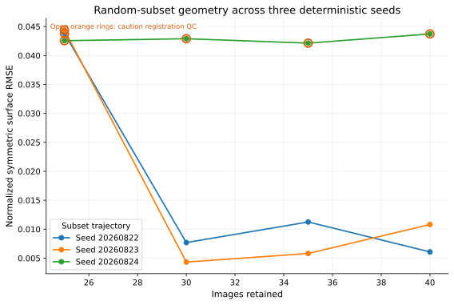
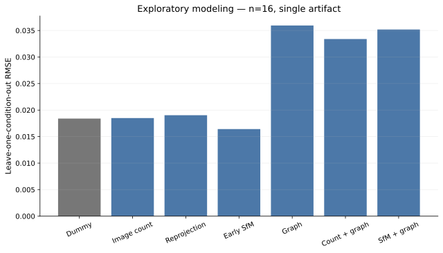

# Predicting Photogrammetric Reconstruction Quality Before Dense 3D Modeling

This research branch of the Aphoma/BD3D cultural-heritage photogrammetry pipeline investigates whether image, overlap, and sparse structure-from-motion evidence can anticipate later 3D surface quality—before expensive dense reconstruction.

## Key findings

- Early sparse reconstruction was highly repeatable across nine identical-condition observations: reprojection RMSE CV was 0.013% and tie-point-count CV was 0.041%.
- Sparse reprojection RMSE was not a reliable standalone quality proxy; its Spearman association with reference-relative geometric error was -0.17.
- At a fixed 30-image count, normalized symmetric surface RMSE ranged from 0.00767 to 0.04357 depending on selection structure.
- A small early-SfM Ridge model improved leave-one-condition-out RMSE by 11.2% over image count and 13.7% over reprojection RMSE.
- That improvement did not survive selection-family extrapolation or pass-QC-only analysis. Current evidence is exploratory, not a production-performance claim.

## Research question

Can measurements available before dense reconstruction predict reference-relative geometric reconstruction error better than conventional indicators such as image count or sparse reprojection RMSE?

The working hypothesis is that sparse observation support and localized camera coverage contain information that image quantity and bundle-adjustment residuals omit.

## Experimental design

The study uses a curated 50-image acquisition of one physical ARF dog artifact. Versioned, SHA-256-validated manifests define nested random subsets at 40, 35, 30, and 25 images across three seeds, plus four structured 30-image conditions: central gap, uniform thinning, removal of weak-overlap images, and removal of strong-overlap images.

Three shared execution profiles separate inexpensive feature studies from geometry and reference output:

- `SFM_ONLY`: alignment and error reduction only;
- `FAST_DENSE`: Medium/Mild depth maps and mesh, without UV/texture/export;
- `FULL_REFERENCE`: High/Mild depth maps, one 4096×4096 texture, and OBJ export.

The current modeling dataset contains **16 FAST_DENSE candidates from one artifact**. FAST_DENSE and FULL_REFERENCE geometry are not pooled.

## Feature engineering

Pre-dense predictors include grayscale sharpness, luminance/contrast/entropy/edge summaries, ORB/FAST/SIFT detector density, pairwise ORB ratio-test matches, thresholded match-graph topology, adjacent acquisition-order overlap, aligned-camera and sparse tie-point statistics, valid observations, and reprojection-error summaries.

## Geometric quality target

Every candidate is compared with the fixed 50-image FAST_DENSE reconstruction. This is a **profile-matched reference reconstruction, not external ground truth**. The evaluator uses deterministic area-weighted surface sampling and centroid-initialized rigid ICP. It permits rotation and translation but never candidate-specific scale or non-rigid deformation.

The primary target is normalized symmetric surface RMSE: bidirectional candidate/reference surface error divided by the reference bounding-box diagonal. Directional accuracy, completeness, p95/p99 error, and threshold fractions provide secondary context.

## Exploratory modeling

Small dummy, image-count, reprojection, early-SfM, graph, and combined predictor families were evaluated with linear and Ridge regression. Continuous predictors were standardized inside each training fold. Validation includes leave-one-condition-out, random-trajectory holdout, selection-family holdout, and pass-QC sensitivity.

The two-feature early-SfM Ridge model performed best under interpolation-oriented and random-trajectory validation, but no feature family beat the dummy baseline under selection-family extrapolation. Graph features were descriptively associated with geometry yet unstable predictively. The central-gap condition motivates a next feature based on the largest angular gap in sparse camera-pose coverage.

## Limitations

The dataset has n=16 related observations from one physical artifact. Its reference is reconstruction-derived, seven candidates have caution registration QC, and nested subsets are not statistically independent. Complex ML and deep learning are not justified. No cross-artifact or production-generalization claim is made.

## Repository structure

| Path | Purpose |
|---|---|
| `photogrammetryScripts.py`, `tasks/`, `UI/` | Original reconstruction pipeline and interfaces |
| `util/ReconstructionMetrics.py` | Versioned run instrumentation |
| `util/ExecutionProfiles.py` | Shared execution-profile controls |
| `util/ExperimentMetadata.py` | Manifest validation and experiment identity |
| `experiments/manifests/` | Reproducible image selections |
| `analysis/` | Image, graph, report, and geometry analysis code |
| `docs/` | Research documentation and figures |

## Documentation and reproducibility

- [Research overview](docs/RESEARCH_OVERVIEW.md)
- [Methods](docs/METHODS.md)
- [Experiments](docs/EXPERIMENTS.md)
- [Results](docs/RESULTS.md)
- [Limitations](docs/LIMITATIONS.md)
- [Data dictionary](docs/DATA_DICTIONARY.md)
- [Reproducibility](docs/REPRODUCIBILITY.md)

Manifest, analysis, and evaluator definitions are versioned. Generated `analysis_outputs` remain intentionally untracked. Repeating reconstruction requires the original images plus a compatible licensed Agisoft Metashape Professional installation; this repository does not provide that proprietary dependency or license.

## Next steps

1. Add a pre-dense maximum angular camera-coverage-gap feature.
2. Replicate the controlled design across multiple artifacts and acquisition geometries.
3. Reserve artifact-level holdout before further model development.
4. Where feasible, evaluate against scanner-derived external geometry.

## Attribution

Aphoma is built on the upstream cultural-heritage asset pipeline developed by **Kea Johnston and contributors** for BD3D workflows. The original project supports manual and Ortery capture, image conversion and masking, Agisoft Metashape reconstruction, model export, and optional Blender presentation renders. Upstream history remains available at `upstream/main`; this research branch extends that operational foundation with instrumentation, reproducible experiments, geometry evaluation, and exploratory analysis.

Agisoft Metashape is proprietary software and is not included in this repository.
