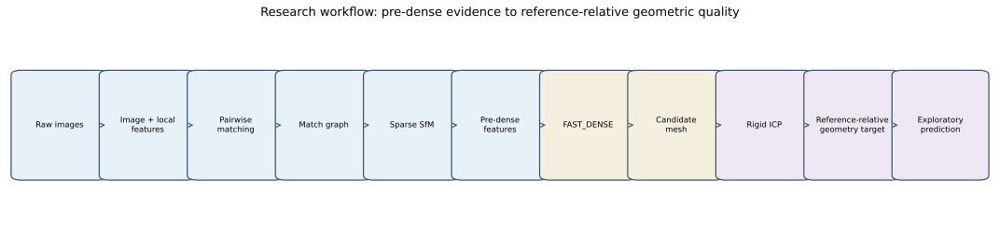

# Research overview

## Context

Aphoma began as BD3D's cultural-heritage photogrammetry asset pipeline: a practical system for moving photographs from manual or Ortery capture through conversion, masking, Agisoft Metashape reconstruction, model export, and optional presentation renders. This research branch retains that operational context while asking:

> Can information available before dense reconstruction predict final, reference-relative geometric reconstruction quality?

Dense depth maps and surface construction are substantially more expensive than image analysis and sparse structure-from-motion (SfM). A defensible early warning signal could identify weak acquisitions before the most expensive stages without assuming that a low sparse reprojection residual implies a complete surface.

## Research progression

1. **Pipeline validation.** The original pipeline was made usable on macOS and validated end to end on a curated 50-image ARF dog acquisition.
2. **Instrumentation.** Each reconstruction gained a versioned JSON report and appendable CSV summary containing inputs, stage state, early SfM measurements, dense-model measurements, timings, outputs, and errors.
3. **Controlled execution.** `SFM_ONLY`, `FAST_DENSE`, and `FULL_REFERENCE` profiles allowed early-feature studies, lower-cost geometric experiments, and reference-quality validation without duplicating reconstruction logic.
4. **Reproducible experiments.** Versioned manifests identify exact images and SHA-256 hashes. Experiment identity is separated from reconstruction `run_id`, so one condition can have repeated executions.
5. **Feature engineering.** Raw-image summaries, local detector densities, pairwise ORB matches, match-graph topology, and early-SfM statistics were computed without dense-model information.
6. **Geometry target.** FAST_DENSE candidates were rigidly registered to a fixed 50-image FAST_DENSE reference. Deterministically sampled bidirectional surface distances produced a normalized symmetric RMSE target and directional accuracy/completeness measures.
7. **Exploratory modeling.** Small linear and Ridge models were evaluated with leave-one-condition-out, trajectory-group, selection-family, and registration-QC sensitivity views.

## Current hypotheses and conclusions

Localized view-coverage gaps appear more consequential than image count alone. Valid sparse observations per image contain useful information, while global graph summaries do not represent where coverage is missing. Sparse reprojection RMSE is not a reliable standalone indicator of dense geometric quality.

Across 16 FAST_DENSE candidates from one artifact, a two-feature early-SfM Ridge model modestly improved primary-target error over dummy, image-count, and reprojection-only baselines under leave-one-condition-out and random-trajectory holdout. That advantage did not survive selection-family extrapolation or restriction to nine pass-QC observations. These are exploratory, reference-relative findings—not production performance or evidence of cross-artifact generalization.

## Next direction

The highest-information next step is a physically grounded coverage feature available before dense reconstruction, such as the maximum angular gap between aligned camera poses around the object, followed by replication across multiple artifacts. External scanner geometry would strengthen target validity where available.

