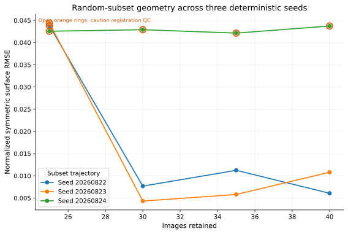
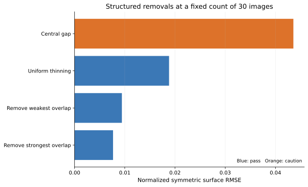
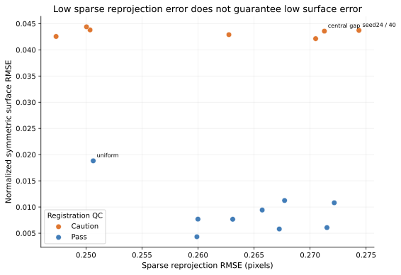
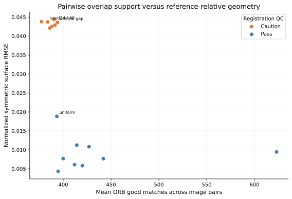
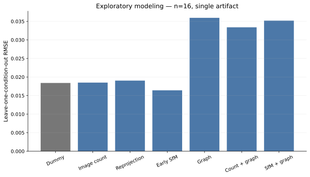

# Results

All values below come from existing reconstruction reports or analysis CSV/JSON. The geometry study has **n=16 candidate observations from one physical artifact**. Its 50-image FAST_DENSE reference is not external ground truth.

## Repeatability and profile runtime

All 50 cameras aligned in each of nine identical early-SfM observations.

| Early measurement | Mean | SD | CV | Range |
|---|---:|---:|---:|---:|
| Tie points | 66,754.0 | 27.63 | 0.041% | 84 |
| Valid observations | 291,970.3 | 86.52 | 0.030% | 284 |
| Reprojection mean (px) | 0.220564 | 0.000025 | 0.011% | 0.000063 |
| Reprojection median (px) | 0.181607 | 0.000015 | 0.008% | 0.000044 |
| Reprojection RMSE (px) | 0.276673 | 0.000037 | 0.013% | 0.000108 |
| Reprojection p95 (px) | 0.542011 | 0.000111 | 0.020% | 0.000377 |

Matching/alignment time was less stable: mean 60.15 s, SD 8.61 s, CV 14.3%. Five SFM_ONLY runs averaged 83.95 s total. The validated 50-image FAST_DENSE run took 198.90 s. Three FULL_REFERENCE runs averaged 707.06 s (range 641.08–792.56 s), with depth maps averaging 460.84 s. These are machine- and workload-specific, not general benchmark claims.

## Random subsets

| Images | Mean y | SD | Minimum | Maximum |
|---:|---:|---:|---:|---:|
| 40 | 0.02020 | 0.02051 | 0.00607 | 0.04372 |
| 35 | 0.01973 | 0.01960 | 0.00580 | 0.04214 |
| 30 | 0.01830 | 0.02137 | 0.00432 | 0.04290 |
| 25 | 0.04358 | 0.00094 | 0.04255 | 0.04439 |

The response was not monotonic above 25 images. Selection identity dominated the 30–40-image range: seed 20260823 reached y=0.00432 at 30 images, while seed 20260824 remained near 0.042–0.044 from 25 through 40. All three 25-image conditions were caution-QC and high-error.

## Structured fixed-count contrasts

| 30-image condition | y | Accuracy at 1% | Completeness at 1% | p95 | Fitness | QC |
|---|---:|---:|---:|---:|---:|---|
| Remove strongest overlap | 0.00767 | 0.901 | 0.857 | 0.01354 | 0.999 | pass |
| Remove weakest overlap | 0.00943 | 0.764 | 0.711 | 0.01802 | 1.000 | pass |
| Uniform thinning | 0.01882 | 0.589 | 0.440 | 0.03750 | 0.996 | pass |
| Central gap | 0.04357 | 0.569 | 0.538 | 0.11854 | 0.849 | caution |

Holding count constant exposed a 5.7-fold y difference between central-gap and remove-strongest conditions. Completeness often fell below accuracy in moderate pass-QC cases, consistent with missing coverage preceding large errors on the remaining surface.

## Sparse reprojection and overlap

Reprojection RMSE and geometric y had Spearman ρ=-0.17. The three 25-image candidates had low reprojection RMSE (approximately 0.247–0.250 px) but the worst random-subset geometry. Sparse residuals describe consistency among retained observations, not full-object coverage.

Mean pairwise good matches had the strongest observed univariate association with y among evaluated pre-dense predictors (Spearman ρ=-0.74), followed by valid observations per image (-0.61) and minimum graph degree (-0.57). These descriptive relationships did not yield stable graph-only prediction under structured holdout.

## Exploratory modeling

| Validation | Dummy | Image count | Reprojection | Early SfM | Graph | Count+graph | SfM+graph |
|---|---:|---:|---:|---:|---:|---:|---:|
| Leave one condition out | 0.01840 | 0.01849 | 0.01903 | **0.01642** | 0.03595 | 0.03339 | 0.03519 |
| Trajectory holdout | 0.01999 | 0.02045 | 0.02093 | **0.01858** | 0.04545 | 0.04599 | 0.04823 |
| Selection-family holdout | **0.01822** | 0.01850 | 0.02089 | 0.02654 | 0.05095 | 0.05125 | 0.05413 |

The two-feature early-SfM Ridge model improved leave-one-condition-out RMSE by 10.7% over dummy, 11.2% over image count, and 13.7% over reprojection. Under trajectory holdout, improvements were 7.0%, 9.1%, and 11.2%. It failed under selection-family extrapolation. Graph families had moderate rank associations but poor absolute errors and leverage-sensitive predictions.

On nine pass-QC candidates, dummy LOOCV RMSE was 0.00458; image count was 0.00503, early SfM 0.00600, and graph 0.00685. Thus the all-data advantage did not survive QC restriction. No tested model supports a general predictive-performance claim.

The central-gap residual exposes missing information in global summaries: graph density may remain respectable while one localized acquisition region is absent. Maximum angular camera-pose gap is the leading next feature hypothesis.
